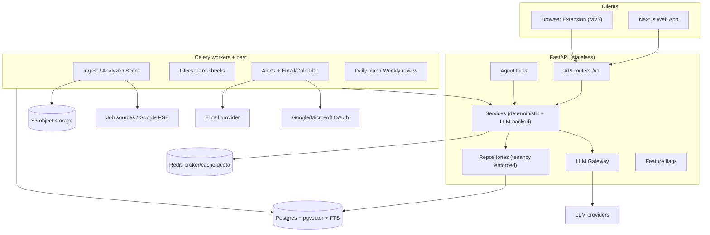
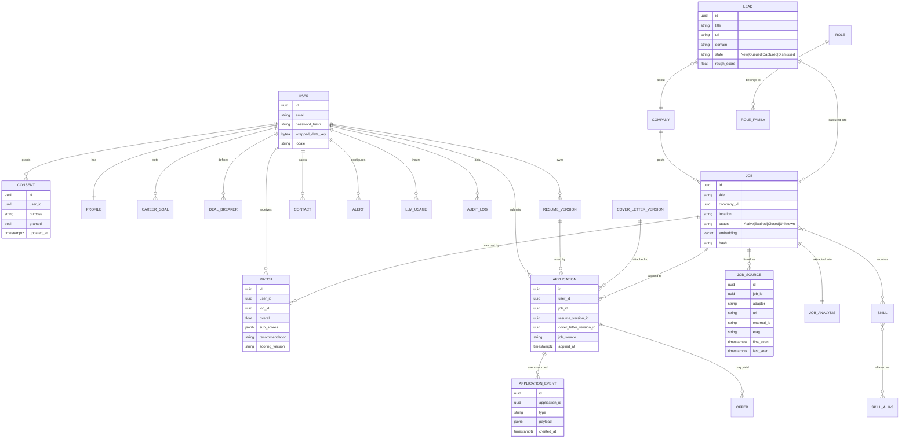

# CareerPilot — Architecture & Design (First Deliverable)

> Status: **design only.** No feature code yet. Awaiting confirmation before Phase 0.
> Scope: the full-lifecycle career platform (Discover → Match → Analyze → Tailor → Prepare →
> Apply → Track → Follow Up → Learn → Improve). Human-in-the-loop; never bypass CAPTCHAs, auth,
> rate limits, `robots.txt`, bot protection, or platform terms.

## A. Architecture overview

CareerPilot is a layered, API-first monolith with independent workers:

- **Clients:** Next.js web app + a Chrome/Edge (MV3) browser extension. Both talk to the same API.
- **Backend:** FastAPI, stateless. Strict layering — `routers / agent-tools → services →
repositories → DB`. Tenancy (`user_id`) is enforced in repositories.
- **Services:** deterministic business logic; the LLM is used only for reasoning/language.
- **Workers:** Celery + Redis for ingestion, analysis, scoring, alerts, lifecycle re-checks,
  email/calendar sync — all idempotent with per-task keys and dead-letter handling.
- **Data:** PostgreSQL (+pgvector, +full-text), Redis (broker/cache/rate-limits), S3-compatible
  object storage (signed URLs, ClamAV on upload).
- **External:** LLM providers behind one **Gateway**; job sources behind adapters; a transactional
  email provider behind an interface.



---

## B. Monorepo folder structure

```
CareerPilot/
├── frontend/                      # Next.js (App Router), React, TS, Tailwind, shadcn, React Query, Recharts
│   ├── app/                       # routes: command-center, profile, jobs, matches, tailor, interview,
│   │                              #         applications, analytics, daily-plan, settings
│   ├── components/  lib/  api/    # UI kit · utils · typed API client (from OpenAPI)
│   └── package.json
├── backend/                       # FastAPI + SQLAlchemy 2 + Alembic
│   ├── app/
│   │   ├── main.py
│   │   ├── core/                  # config, db, security(JWT), crypto, logging, flags
│   │   ├── models/  schemas/      # SQLAlchemy models · Pydantic (API + LLM output schemas)
│   │   ├── repositories/          # tenancy-scoped DB access (enforced + tested)
│   │   ├── services/              # business logic (deterministic + LLM-backed)
│   │   ├── api/v1/                # thin routers, versioned
│   │   ├── adapters/              # JobSource + DiscoverySource adapters + registry
│   │   ├── agents/                # AI Career Agent tools (call the same services)
│   │   ├── prompts/               # versioned prompt files
│   │   ├── gateway/               # LLM gateway (providers, budgets, redaction, cache)
│   │   └── workers/               # celery_app + tasks
│   ├── alembic/                   # migrations
│   ├── tests/                     # unit · integration · evals (golden sets)
│   └── pyproject.toml
├── extension/                     # Chrome/Edge MV3 (Save · Score · Autofill)
├── infra/                         # docker-compose, Dockerfiles, minio, clamav, postgres init
├── docs/                          # this deliverable + API.md, ROADMAP.md, COMPLIANCE.md
├── .github/workflows/             # CI: lint, type, test, evals, dependency + secret scanning
└── README.md
```

---

## C. ER diagram (Mermaid)



_(Indicative core; not every table is shown. Taxonomy tables `ROLE`, `ROLE_FAMILY`, `SKILL`,
`SKILL_ALIAS` are data, editable without code changes.)_

---

## D. API design

**Style:** REST/JSON, versioned at `/api/v1`. OpenAPI generated by FastAPI (`/docs`, `/redoc`).

**Auth model**

- `POST /api/v1/auth/register`, `/auth/login`, `/auth/refresh`, `/auth/logout`, `/auth/verify-email`,
  `/auth/password-reset`.
- **Access token:** short-lived JWT (`Authorization: Bearer`). **Refresh token:** rotating, stored in
  an httpOnly+Secure+SameSite cookie → CSRF protection on cookie-based routes.
- Every resource is scoped to the authenticated `user_id` in the repository layer. Extension uses a
  **scoped, revocable token** with a narrower permission set.

**Resource list (v1)**
| Area | Endpoints |
|---|---|
| Profile | `/profile`, `/career-goals`, `/deal-breakers` |
| Resumes | `/resumes`, `/resume-versions` (create/list/export), `/resume-versions/{id}/ats-report` |
| Jobs | `/jobs`, `/jobs/{id}`, `/jobs/{id}/sources`, `/leads`, `/leads/{id}/capture` |
| Matching | `/matches`, `/matches/{id}` (+ `POST /matches/recompute`) |
| Tailoring | `/resume-versions/{id}/tailor`, `/tailor-runs/{id}` (diff + per-change approve/reject) |
| Cover letters | `/cover-letter-versions` |
| Applications | `/applications`, `/applications/{id}/events`, `/offers` |
| Interview | `/interview-kits`, `/practice-sessions`, `/star-stories` |
| Insights | `/analytics/funnel`, `/analytics/rates`, `/skill-gap`, `/learning-roadmap` |
| Alerts | `/alerts`, `/alerts/{id}/runs`, `/alerts/preview` |
| CRM | `/contacts`, `/follow-ups`, `/outreach-drafts` |
| Email/Cal | `/integrations`, `/emails`, `/emails/{id}/suggest`, `/calendar-suggestions` |
| Plan/Agent | `/daily-plan`, `/weekly-review`, `/agent/tools`, `/agent/invoke` |
| Platform | `/health`, `/ready`, `/feature-flags`, `/consents`, `/data-export`, `/account` (DELETE) |

**Versioning:** path-prefixed (`/api/v1`). Breaking changes → new version; additive changes stay.
Response schemas mirror the LLM output schemas so extraction contracts are single-sourced.

**Pagination:** cursor-based for lists — `?limit=&cursor=` → `{ items, next_cursor }`. Offset-based
only where a total count is essential (e.g. analytics). All list endpoints paginated (NFR).

**Error format:** RFC 7807 `application/problem+json`:

```json
{
  "type": "https://careerpilot/errors/validation",
  "title": "Validation failed",
  "status": 422,
  "detail": "expected_salary must be >= 0",
  "instance": "/api/v1/profile",
  "request_id": "01J..."
}
```

---

## E. Agent / service architecture and LLM gateway

**Layering (strict):** `routers / agent-tools → services → repositories → DB`.
Routers and agent tools are thin and call the **same services** — no agent-only logic.

**Services vs agents:** deterministic logic lives in plain services (dedupe, lifecycle, scoring
sub-scores, planner, scam signals, normalization, quotas). The LLM is used only where reasoning or
language is needed (extraction, tailoring, cover letters, interview kits, explanations, phrasing).
Where a decision must be reproducible, the deterministic service decides and the LLM just words it.

**AI Career Agent:** natural-language commands via **tool calling over the service layer**. Read
tools run freely; **write tools require a confirmation card**. **Every tool call is audit-logged**,
which also feeds "why did this change?" explanations (e.g. personalized ranking).

**LLM Gateway (`gateway/`)**

- One interface over **OpenAI / Anthropic / Gemini / OpenAI-compatible**.
- Responsibilities: retries, timeouts, provider fallback, response **caching**, **structured output**
  (Pydantic-validated) with a **retry-and-repair loop**, **PII minimization/redaction**,
  **per-user budgets**, model tiering (cheap model for extraction, stronger for tailoring), and
  **usage logging** to `llm_usage`.
- **Prompts are versioned files** under `prompts/`, never inline strings.
- **Untrusted input:** job descriptions are delimited, hidden text stripped, and prompts given **no
  tool access** (prompt-injection defense). Same treatment for tailoring/cover-letter prompts.
- **No training on user data** without explicit, revocable consent (`consents`).
- Provider data-flow is documented (which providers receive what).

---

## F. Phased roadmap with acceptance criteria

_Phase numbering: **Phase 0 = Foundation** (confirmed — the earlier "Phase 1" was a typo)._

**Phase 0 — Foundation** _(repo, Docker, CI, config, logging, migrations, auth skeleton, LLM gateway, test harness)_

- Acceptance: `docker compose up` healthy; `/health` + `/ready` green; Alembic baseline applied;
  CI runs ruff + mypy + pytest on every push; LLM gateway returns a schema-validated response from a
  recorded/mocked provider; structured logs carry a `request_id`.

**Phase 1 — Profile, Resume & Career Goal**

- Acceptance: onboarding wizard yields a usable profile in < 5 min; PDF + DOCX upload → parsed
  profile with **per-section confidence** and correction; GitHub + LinkedIn-export imports merge into
  the canonical profile; resume **versions** are append-only; export yields ATS-safe PDF **and** DOCX;
  career goal + deal-breakers stored and editable.

**Phase 2 — Ingestion & Discovery**

- Acceptance: `JobSource` adapters (Greenhouse, Lever, Ashby, SmartRecruiters, RSS, UserURL) and the
  **Google PSE `DiscoverySource`** run on schedule; raw + normalized + fetch metadata stored;
  cross-source **dedupe** resolves to one canonical job with a **possible-duplicate** review state;
  URLs canonicalized; leads have the New→Queued→Captured→Dismissed lifecycle; quota guard + 24 h
  query cache; every outbound fetch logged; LinkedIn/Naukri/Indeed remain **disabled stubs**.

**Phase 3 — Matching, Lifecycle & Bookmarklet Apply**

- Acceptance: match produces overall 0–10 + sub-scores with **`scoring_version`** and is
  reproducible; Matched/Partial/Missing shown with resume evidence; **non-Active jobs never
  recommended**; lifecycle states update on schedule; duplicate-application warning; bookmarklet /
  paste-URL capture creates/updates a job and starts an application.

**Phase 4 — Browser Extension & Application Tracker**

- Acceptance: MV3 extension does Save / Score / Autofill on the **visible page only**; no background
  crawling; unknown/sensitive fields left blank + highlighted; attachments offered from saved
  versions; **pre-submit checklist** gating; "I applied" writes an `application_events` row; Kanban,
  list and timeline views derive from the event log.

**Phase 5 — Tailoring, ATS Analyzer & Cover Letters**

- Acceptance: tailoring output is a new `resume_version`; **every claim maps to a master-resume
  source span** — unmapped claims are **blocked**; side-by-side diff with per-change approve/reject;
  ATS report /100 + **parse test** on the exported PDF; cover letters grounded only in
  profile/resume/JD, versioned.

**Phase 6 — Analytics, Rejection Intelligence, Alerts & Email/Calendar**

- Acceptance: funnel/rates from `application_events`; breakdowns by source/resume-version/role/
  location; A/B tests and insights enforce **min-N guards**; personalized ranking is transparent and
  resettable; alerts run idempotently with per-run logs, digest batching, quiet hours, unsubscribe,
  preview; Gmail/Outlook read-only classification populates a **status review queue**; calendar
  suggestions add only on confirm.

**Phase 7 — Interview Prep, Skill Gap & Daily Plan**

- Acceptance: personalized interview kits; timed practice with rubric scoring + history; STAR bank
  linked to resume items; skill-gap demand % + marginal-coverage gain; learning roadmap linked to the
  daily plan; Command Center aggregates goal/funnel/today/insight with **evidence links**.

**Phase 8 — AI Career Agent & Deploy Path**

- Acceptance: natural-language agent runs read tools freely and write tools only via confirmation
  cards; every tool call audit-logged; prod Dockerfiles + one-command deploy; provider data-flow +
  retention docs published.

---

## G. Technology decisions (reasons + alternatives considered)

| Decision                                     | Reason                                                                              | Alternatives considered                                                                      |
| -------------------------------------------- | ----------------------------------------------------------------------------------- | -------------------------------------------------------------------------------------------- |
| **Next.js** frontend                         | SSR/SSG, routing, deploy flexibility, fast first paint                              | Vite+React (simpler, no SSR) — _superseded_; Remix; SvelteKit                                |
| **FastAPI** backend                          | Async, typed, auto OpenAPI, Python AI/scraping ecosystem                            | Django (batteries, heavier); Flask (no async/typing); Node/TS (unified lang, weaker AI libs) |
| **Pydantic v2**                              | One schema for API **and** LLM structured output                                    | dataclasses + manual validation; marshmallow                                                 |
| **SQLAlchemy 2 + Alembic**                   | Typed ORM, migrations, pgvector support                                             | Django ORM; raw SQL; Tortoise                                                                |
| **Postgres + pgvector**                      | Relational + full-text + vectors in one store                                       | Separate vector DB (Pinecone/Weaviate) — extra ops; MySQL (no native vectors)                |
| **Redis**                                    | Celery broker + cache + rate-limit/quota counters                                   | RabbitMQ (broker only); in-memory cache (not shared)                                         |
| **Celery**                                   | Mature, beat scheduling, DLQ patterns, ecosystem                                    | RQ (lighter, fewer features); Dramatiq; cloud queues                                         |
| **Browser extension (MV3)** for apply        | Runs in the user's real browser; no server session cookies; robust                  | Playwright headed (superseded — brittle, server-side); manual-only                           |
| **S3-compatible storage**                    | Portable (MinIO local ↔ cloud S3), signed URLs                                      | Local disk (superseded — not deployable); DB blobs (bad for big files)                       |
| **Google Programmable Search** for discovery | Official API discovers links without crawling                                       | Scraping (violates ToS); direct platform APIs (partner-only)                                 |
| **JWT access + rotating refresh cookie**     | Stateless API + revocable sessions + CSRF defense                                   | Pure session cookies; long-lived JWT (worse)                                                 |
| **LLM Gateway** abstraction                  | Provider portability + budget/redaction/caching in one place                        | Direct SDK calls (scattered, no budget control)                                              |
| **OpenAI (ChatGPT)** as default provider     | Confirmed default; OpenAI-compatible interface keeps Anthropic/Gemini/local drop-in | Anthropic (strong reasoning); Gemini; local Ollama (offline/private)                         |
| **Next.js as thin BFF** (in addition to UI)  | Session handling + response aggregation close to the UI                             | Pure client-side fetch against FastAPI; separate API gateway                                 |
| **Extension: load-unpacked / internal**      | Fits self-hosted-per-person; no store review or fees                                | Chrome Web Store + Edge Add-ons (needs privacy policy + review)                              |
| **Gmail-only email integration first**       | Smallest read-only scope; prove classification before Outlook/calendar              | Gmail + Outlook at once (more OAuth surface)                                                 |

---

## H. Local setup instructions

```bash
# 1. Infrastructure (Postgres+pgvector, Redis, MinIO, ClamAV)
docker compose -f infra/docker-compose.yml up -d

# 2. Backend
cd backend
python -m venv .venv
# Windows: .venv\Scripts\activate   |  macOS/Linux: source .venv/bin/activate
pip install -e ".[dev]"
cp .env.example .env          # add LLM + Google PSE keys as needed
uvicorn app.main:app --reload # http://localhost:8000/docs

# 3. Frontend
cd ../frontend
npm install
npm run dev                   # http://localhost:3000

# 4. Extension (later phases)
cd ../extension && npm install && npm run dev   # load unpacked in Chrome/Edge
```

Checks: `curl localhost:8000/health` · `/ready`. Tests: `pytest` (backend), `npm test` (frontend).

---

## I. Compliance & risk register

| #   | Risk                                                       | Likelihood / Impact | Mitigation                                                                                                                                                       |
| --- | ---------------------------------------------------------- | ------------------- | ---------------------------------------------------------------------------------------------------------------------------------------------------------------- |
| I1  | **ToS violation / account ban** (LinkedIn, Naukri, Indeed) | Med / High          | Disabled stubs; official APIs/partner programs/extension only; **no scraping behind logins**; never fetch those pages server-side                                |
| I2  | **`robots.txt` / crawl etiquette**                         | Low / Med           | Honor `robots.txt` + crawl-delay; per-domain rate limits + backoff; log every outbound fetch                                                                     |
| I3  | **Privacy / PII exposure** (DPDP, GDPR)                    | Med / High          | Encryption at rest (envelope + field-level); minimized journal; **cascading erasure across DB+S3+vectors+caches, test-verified**; export; consent-gated training |
| I4  | **LLM hallucination** (fake experience/metrics)            | Med / High          | Deterministic core decides; **fact-grounding verifier** blocks unmapped claims; ATS/honesty rules; hallucination eval suite in CI                                |
| I5  | **Cost blowout** (LLM + Google PSE)                        | Med / Med           | Per-user budgets, caching, model tiering, `llm_usage` logging, Google PSE quota guard + 24 h query cache                                                         |
| I6  | **Prompt injection via job descriptions**                  | Med / High          | JDs are untrusted: delimited, hidden text stripped, **no tools** on analysis prompts                                                                             |
| I7  | **Scam job postings**                                      | Med / Med           | Scam signal engine → "potentially suspicious" (never a fraud assertion) + report/dismiss loop                                                                    |
| I8  | **Over-claiming from small samples**                       | Med / Med           | Statistical honesty: sample sizes shown; insights/A-B suppressed below N                                                                                         |
| I9  | **Secrets leakage**                                        | Low / High          | Secrets via env/secret manager; keys never reach frontend; dependency + secret scanning in CI                                                                    |
| I10 | **Model-provider data flow**                               | Med / Med           | PII minimization/redaction before calls; documented data-processing summary                                                                                      |

---

## J. Open questions — resolved & remaining

**Resolved**

| #   | Question               | Decision                                                                                                                  |
| --- | ---------------------- | ------------------------------------------------------------------------------------------------------------------------- |
| J1  | Phase numbering        | **Phase 0 = Foundation** (earlier "Phase 1" was a typo)                                                                   |
| J2  | Default LLM            | **OpenAI (ChatGPT)**; gateway keeps Anthropic/Gemini/local drop-in                                                        |
| J3  | Workers                | **Celery** (+ Redis)                                                                                                      |
| J4  | Next.js role           | **UI + thin BFF**                                                                                                         |
| J5  | Google PSE             | **Feature-flagged OFF** until keys added; global cap at the free 100/day + per-user sub-cap; 24 h query cache             |
| J6  | Personalized ranking   | **Separate, resettable layer** on the reproducible base score                                                             |
| J7  | Extension distribution | **Load-unpacked / internal**                                                                                              |
| J8  | Email scope            | **Gmail only first** (Outlook + calendar later)                                                                           |
| J9  | Compliance docs        | **I draft** the data-retention policy + data-processing summary — see `docs/DATA-RETENTION.md`, `docs/DATA-PROCESSING.md` |
| J10 | Deployment             | **Self-hosted now, cloud later** — multi-tenant-safe data layer, shipped per-person                                       |

**All open questions resolved.**

---

### Stop point

Design deliverable A–J complete. **No Phase 0 code will be written until you confirm** (and answer
J1–J10 as you see fit).
